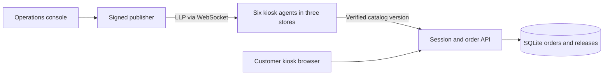

# FOLD Coffee & Patisserie


FOLD is a cashier-operated coffee shop register, a self-service kiosk, and a retail rollout experiment built on [Live Layer Protocol](https://github.com/nik190799/live-layer-protocol). The core menu has 57 distinct items across coffee, specialty drinks, tea and matcha, refreshers, patisserie, and kitchen. The operations console manages the queue and pilots a revised pickup flow across a simulated storefront fleet. The seasonal release expands the menu to 59 items.

## Run locally

Use Git, npm, and Node 22.13 or newer. The first command installs the dependencies of the pinned upstream checkout rather than using an existing global copy of LLP.

```sh
npm run setup
npm start
```

- [Cashier register](http://127.0.0.1:17730/)
- [Self-service kiosk](http://127.0.0.1:17730/kiosk)
- [Customer counter display](http://127.0.0.1:17730/counter)
- [Kitchen board](http://127.0.0.1:17730/kitchen)
- [Operations console](http://127.0.0.1:17730/ops)
- [Customer pickup display](http://127.0.0.1:17730/pickup)
- [Sales reports](http://127.0.0.1:17730/sales)
- [Terminal Lab](http://127.0.0.1:17730/terminal-lab)
- [Search all 100 release changes](http://127.0.0.1:17730/improvements)

`FOLD_PORT` sets the HTTP port, `FOLD_DATA` selects the SQLite and generated Wasm directory, and `LLP_ROOT` selects an existing LLP checkout. The default data directory is `.fold-data/`, which should remain local. Restarting against the same data directory restores the published menu assignments, accepted orders, and server-side session versions.

## Ring up a sale

Open the register, choose a location, and tap item keys to build a ticket. Use the ticket controls for modifiers, quantities, and removals. In the tender screen, select **Cash** and enter the amount received, or choose **Demo card**. The server validates the total and calculates change in cents. Each completed sale creates a receipt and goes to the same kitchen queue as a kiosk order.

Use **Park** to hold a named ticket while serving another guest. Recall uses the original menu version even after a rollout. The register also lets staff adjust tips and discounts, add an internal prep note, reopen recent receipts, and customize quick keys. Parked tickets and quick keys follow the register inside the same browser profile. Open **Customer display** from the register to mirror buyer-visible details in another tab of that browser.

Use **Kitchen** for a station and store view of prep and handoff, and **Operations** for stock overrides and full demo refunds. Kitchen status is shared across a ticket, so advancing mixed-station work changes the whole ticket. **Sales** reconciles orders and refunds by store and UTC date and can export the filtered data as CSV.

## Screen targets and the 100 changes

Terminal Lab embeds the actual app at **1920 × 1080**, **1280 × 800**, **1366 × 768**, or a custom CSS viewport. It can measure horizontal overflow and primary touch targets, and download the diagnostics as JSON. [Hardware research and limits](docs/hardware.md)

The release ledger links 100 changes to their source. [Register](docs/register-improvements.md) · [Backend](docs/backend-improvements.md) · [Kitchen, operations and pickup](docs/operations-improvements.md) · [Customer display, terminal preview and sales](docs/counter-improvements.md)

## Try a live rollout

If the demo already has v2 installed, use **Roll back fleet** in Operations to start from v1.

1. In the kiosk, select **Market Street · Kiosk 02** on the beta channel. Add a Flat White to your cart and leave the order open.
2. In Operations, publish **Seasonal Menu** to **Beta** at **100%**. Check which kiosks acknowledged the signed release. The three stable kiosks keep their prior menu.
3. Finish your existing order on the kiosk. Its menu price and **Collect at the bar** instructions remain pinned to v1.
4. Start a new order on the same beta kiosk. It now has Maple Cloud Latte and Pear Frangipane Tart, a revised Flat White price, and new pickup shelf instructions. Send a demo order and advance it in the Operations queue. The customer pickup display shows the order number moving to **Ready** at the selected store.
5. Roll back through Operations. The fleet returns to the core menu for new sessions. Existing sessions and order history retain their respective versions.

## How the experiment works

The Node service compiles catalog and pickup policy into AssemblyScript WebAssembly layers. Its publisher signs per-device, content-addressed manifests. Simulated kiosk agents receive them over local WebSockets and apply them with upstream LLP `LiveHost` instances. Devices send acknowledgements after verification and rendering. The rollout uses upstream deterministic cohort bucketing and stores the desired and acknowledged states separately.

The order service pins each session to a verified version. It validates items and modifiers against that version, calculates totals in integer cents, and stores each order once per session with an idempotency key. The browser provides the responsive ordering and operations interfaces. The simulated device agents run beside the service, so this setup can test protocol and transaction behavior on one computer.



## Verification

```sh
npm test
npm run stress -- --rounds 12 --clients 12
```

The stress command runs an isolated service and repeatedly races order checkout with beta deployment and fleet rollback. It checks that old and new sessions retain the correct prices, retry responses reference the original order, and stable kiosks stay on v1. Results are written under `.soak/` and printed to the terminal.

A Windows run on Node 22.23.5 completed 32 rollout and rollback rounds with 36 concurrent clients, accepted 2,304 demo orders, and confirmed 384 duplicate retries. Checkout p95 was 910 ms. This measures local HTTP requests during the test and does not include customer input or payment processing.

The service binds to loopback and simulates checkout without collecting payment details. It has no external payment processor, kitchen hardware, production access control, or independently deployed physical kiosks. Those are prerequisites for a store deployment. Menu photography and font attribution are documented in [ART.md](ART.md) and [public/fonts](public/fonts).

FOLD's demo menu draws inspiration from Chicago independent cafés, including the specialty drinks and lunch offerings at [necessary & sufficient coffee](https://www.necessary-coffee.com/menu), [Oromo Cafe's Lincoln Square menu](https://www.oromocafechicago.com/menu-lincoln-square-5), and [Kasama's daytime ordering menu](https://order.toasttab.com/online/kasama-1001-north-winchester-avenue). The menu, prices, and photography were created for the experiment.
